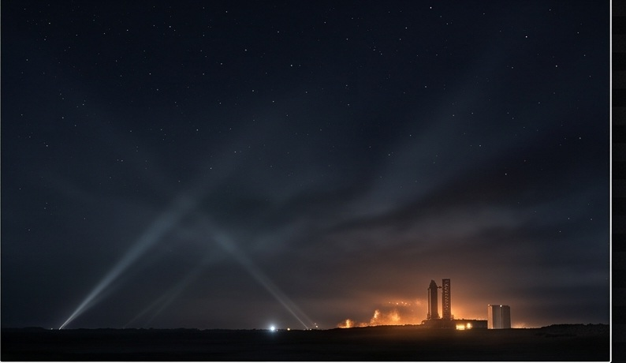

<div align="center">

# 🚀 Starship Catch RL

### Teach a booster to survive the hardest part of landing: being caught.

<p>
  <a href="https://github.com/Jaswanthh22/Starship_landing">
    
  </a>
  
  
  
</p>

<p>
  A 2D reinforcement-learning flight simulator where a reusable booster must
  control throttle, engine gimbal, and attitude to hit a narrow catch window.
</p>

<a href="videos_profile/rl-video-episode-0.mp4">
  
</a>

<p><sub>▶ Click the image to watch a recorded profile-policy flight.</sub></p>

</div>

---

## The mission

The booster starts hundreds of metres above the tower, falling fast and carrying limited fuel. At the catch height, the policy must satisfy all of these conditions at once:

| Target | What must be true |
| --- | --- |
| Position | The booster is centred over the tower |
| Horizontal speed | Sideways drift is almost zero |
| Vertical speed | Descent is gentle enough to be caught |
| Attitude | The vehicle is upright |
| Rotation | The vehicle is not tumbling |

Miss one constraint and the catch becomes a miss. Land the entire state inside the window and the agent earns the win reward.

## Why this is interesting

- **A real control problem:** the policy has to brake, steer, and stabilise simultaneously.
- **Sparse success signal:** a catch is worth `+100`; misses are graded by how far they are from the catch envelope.
- **Curriculum learning:** training begins with forgiving conditions and progressively tightens the tolerances.
- **Reward-shaping experiments:** compare a naive hover-friendly reward with shaping that actually encourages a suicide-burn descent.
- **Built-in visualisation:** watch the booster fly in Pygame or export episodes as MP4 videos.
- **Reproducible evaluation:** evaluation uses fixed held-out seeds so experiments can be compared fairly.

## Quick start

```bash
# 1. Clone the project
git clone https://github.com/Jaswanthh22/Starship_landing.git
cd Starship_landing

# 2. Create an isolated environment
python -m venv .venv
source .venv/bin/activate          # Windows: .venv\Scripts\activate

# 3. Install dependencies
python -m pip install --upgrade pip
python -m pip install -r requirements.txt
```

The repository includes a trained `profile` policy, so you can evaluate it immediately:

```bash
python evaluate.py profile --difficulty 1.0 --episodes 100
```

You can also run the hand-written suicide-burn controller as a simple baseline:

```bash
python scripted_pilot.py --episodes 100
```

## Watch it fly

Open a live Pygame window with the scripted controller:

```bash
python scripted_pilot.py --render
```

Record deterministic flights from a trained policy:

```bash
python record.py profile --difficulty 1.0 --episodes 3
```

Videos are written to `videos_profile/`. The included recordings can be opened directly from the repository:

- [Flight 1](videos_profile/rl-video-episode-0.mp4)
- [Flight 2](videos_profile/rl-video-episode-1.mp4)
- [Flight 3](videos_profile/rl-video-episode-2.mp4)

## Train your own policy

The default experiment uses PPO with eight parallel environments and an automatic curriculum:

```bash
python train.py profile --steps 2000000 --envs 8 --device auto
```

Useful variations:

```bash
# Train without curriculum, directly at maximum difficulty
python train.py profile --no-curriculum --steps 2000000

# Compare reward designs
python train.py baseline --steps 500000
python train.py timecost --steps 500000
python train.py hover --steps 500000
python train.py fixed --steps 500000
python train.py profile --steps 500000
```

The trained model is saved as `ppo_<variant>.zip`.

## Environment at a glance

`StarshipCatch-v0` is a lightweight 2D Gymnasium environment running at 20 Hz.

### Observation space — 7 values

```text
[horizontal offset, altitude, horizontal velocity, vertical velocity,
 tilt angle, angular velocity, remaining fuel]
```

The values are normalised before being passed to the policy.

### Action space — 3 continuous controls

```text
[throttle, engine gimbal, attitude-control torque]
```

Each action is supplied in `[-1, 1]`. The environment maps these values to engine thrust, gimbal angle, and RCS torque.

### Difficulty

Difficulty ranges from `0.0` to `1.0` and controls both the starting-state spread and the catch tolerances. At maximum difficulty, the window is intentionally unforgiving:

- ±3 m horizontal position
- ±1.5 m/s horizontal velocity
- ±2 m/s vertical velocity
- ±0.04 rad tilt
- ±0.10 rad/s angular velocity

## Reward experiments

The training script exposes five variants so the effect of reward design is easy to inspect:

| Variant | Purpose |
| --- | --- |
| `baseline` | The raw catch/miss reward from the environment |
| `timecost` | Adds a small penalty for every frame |
| `hover` | Demonstrates how “upright and slow” shaping can reward hovering instead of catching |
| `fixed` | Rewards improvement toward the target state while charging a time cost |
| `profile` | Uses altitude-aware braking targets so the agent learns a genuine suicide-burn profile |

The `profile` variant is the recommended starting point.

## Project map

```text
.
├── catch_env.py          # Physics, rewards, Gymnasium API, and Pygame renderer
├── wrappers.py           # Reward-shaping variants
├── train.py              # PPO training, parallel environments, and curriculum
├── evaluate.py           # Deterministic held-out evaluation
├── record.py             # MP4 flight recording
├── scripted_pilot.py     # Non-RL suicide-burn baseline
├── random_agent.py       # Random-action sanity check
├── assets/               # Booster, tower, ground, flame, and background art
├── ppo_profile.zip       # Included trained profile policy
└── videos_profile/       # Example recorded flights
```

## Reproducibility notes

- PPO uses seed `1` for training.
- Evaluation uses seeds `10_000` onward, separate from training order.
- The environment supports explicit per-episode seeds through Gymnasium's `reset(seed=...)` API.
- Training automatically selects CUDA when available with `--device auto`; use `--device cpu` to force CPU training.

## Built with

[Gymnasium](https://gymnasium.farama.org/) · [Stable-Baselines3](https://stable-baselines3.readthedocs.io/) · [PyTorch](https://pytorch.org/) · [Pygame](https://www.pygame.org/)

## License

This project is provided for experimentation and learning. Add a license file before distributing it as a reusable library or using it in a larger project.

<div align="center">

### Can your policy catch the booster before it runs out of sky?

</div>
